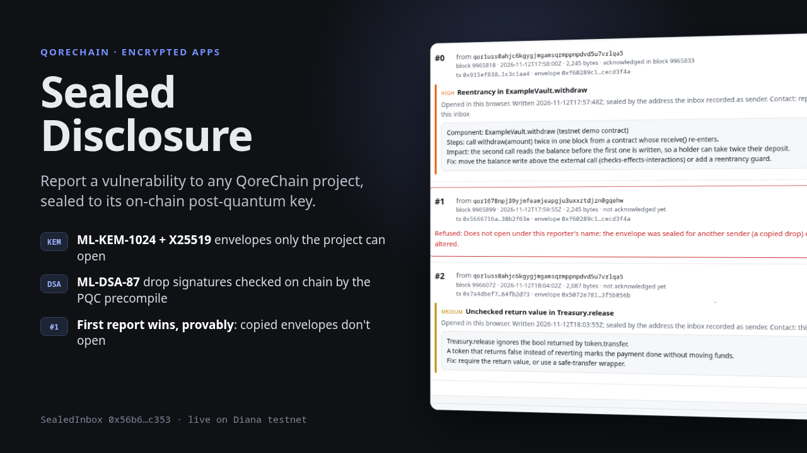

# Sealed Disclosure

Post-quantum vulnerability disclosure for QoreChain projects.

A security researcher who finds a bug in a QoreChain project has two bad options today: post it in a public
channel, or mail it to an address nobody can verify and hope it gets read. Neither proves who reported first.

Sealed Disclosure gives every QoreChain account an encrypted, on-chain inbox:

- **Sealed to the project's on-chain key.** The report is encrypted with ML-KEM-1024 + X25519 (QoreSeal) to the
  key the project registered in QoreChain's KEM key registry. Only the project can read it; nobody else can,
  including whoever relays the transaction, now or after a quantum computer arrives.
- **Signed by the reporter's post-quantum key.** The reporter signs a short drop statement with their ML-DSA-87
  account key (QoreSign). The `SealedInbox` contract checks that signature on chain with the PQC Verify precompile,
  against the key the PQC Key Status precompile says the reporter registered and proved possession of.
- **First report wins, provably.** Each drop is stored with its block. The order of reports is public, their
  content is not. The envelope's authenticated data names the reporter, so a copied envelope dropped under
  someone else's name does not open: the project can tell the genuine first report from a copy.
- **Signed receipts.** The project acknowledges a drop with its own ML-DSA-87 signature, so the reporter has
  proof the report was received.

It works from the command line and in the browser.



## Live on QoreChain testnet (Diana)

| What | Where |
| --- | --- |
| `SealedInbox` contract | `0x56b6706d009db5357ee076e62c7c7e317e45c353` (EVM, chain id 9800) |
| Deploy tx | `0x859f4c0aedc4e819ad3c4582f7f4793e5ee86cf3eae8caa6b23733c17d70d4ae` (block 9965775, 1,598,049 gas) |
| Demo project | `qor1knxej2kffzpx9hcfjd54argxj72vs962nw60fg` |
| Demo reporter | `qor1uss0ahjc6kgygjmgamsqrmppnpdvd5u7vrlqa5` |
| Second reporter (copies drop #0) | `qor1678npj39yjmfeamjeapgju3uxxrtdjzn0gqehw` |

Transactions of the end-to-end run (Cosmos hashes open at
`https://api-testnet.qore.host/cosmos/tx/v1beta1/txs/<hash>`; EVM hashes on `https://evm-testnet.qore.host`):

| Step | Tx |
| --- | --- |
| Project registers its ML-DSA-87 key | `C57C78EA4C7E33280A63FCF21003321141964D867C11F174B3A44550654C6160` |
| Project registers its ML-KEM-1024 key | `CA2E5552977ADFBFBDE67116BCAADE93B8300E97C249220FE67DDEA2571E5726` |
| Project publishes its recipient card | `0x352d7b1176472960105eb552bfb110236fcb0b0322dbaa6701ff6101edf6c4f8` (block 9965788) |
| Reporter registers its ML-DSA-87 key | `0398795F70032DBC28310D046A321AE2C298440EF218912CA4FB0BCC449E5C98` |
| Drop #0 (sealed by the CLI) | `0x915ef838efdaeee4749fa70764dc7385da2f93bebc51b57dedc59dd21c3c1aa4` (2,245 bytes) |
| Project's signed receipt for #0 | `0xf1826ed8d2386cd445157546f03fe1b20e3c19660ad1fe133ba313713e00e73a` (block 9965833) |
| Drop #1 (the same envelope, dropped by the second reporter) | `0x5666716a8be51fdca5a8f9b22803561ed403faaf1e0ae89ac9422fad38b2f63e`: accepted, but does not open |
| Drop #2 (sealed in the browser, dropped by the CLI) | `0x7a4dbef7ad85c22aa6eb760b4fd6389b3b6a496152b07c1dee03ad7464fb2d73` (2,087 bytes) |

Each EVM write is sent by the account's relayer inside a hybrid-signed EVM window scoped to the inbox, one
transaction and the estimated fee at most, e.g. `7E0BE970BB27661FF58FFE61765620D15C0C69E65DD98FA9838F374388C124D2`
(deploy) and `CB8774F6BBCE5728E30BD89299BF24D9CDAD3C7E3741BA36B39FD609A40B83E7` (drop #2).

The captured output of these runs is in [`docs/e2e/`](docs/e2e).

## How it works

```
 project                          SealedInbox (EVM)                      reporter
 ───────                          ─────────────────                      ────────
 register ML-DSA-87 key  (PQC module, with proof of possession)
 register ML-KEM-1024 key (KEM registry)
 sign recipient card ───────────► publishCard: card text must name this
 (secp256k1 + ML-DSA-87)          chain and account, be newer than the last,
                                  and carry the account's ML-DSA-87 signature
                                                                          check the project: KEM key,
                                                                          ML-DSA key, card verifies
                                                                          seal report (ML-KEM-1024 + X25519,
                                                                          AES-256-GCM, AAD = from/to)
                                  drop ◄──────────────────────────────── sign "Sealed Disclosure drop v1"
                                  rebuilds the statement (chain, inbox,   with ML-DSA-87
                                  from, to, SHA-256 of the envelope),
                                  checks it with precompile 0x0a01,
                                  stores the drop and its block
 read drops, open with the
 seal key; a copy under another
 name fails the AAD check
 acknowledge ───────────────────► acknowledge: receipt statement signed
                                  by the recipient's ML-DSA-87 key
```

The statements the keys sign are plain text that the contract rebuilds byte for byte (`dropText`, `receiptText`),
so a wallet that shows what it signs shows exactly what the inbox will accept. The client refuses to sign when the
contract's text differs from its own.

```
Sealed Disclosure drop v1
Chain ID: qorechain-diana
Inbox: 0x56b6706d009db5357ee076e62c7c7e317e45c353
From: qor1uss0ahjc6kgygjmgamsqrmppnpdvd5u7vrlqa5
To: qor1knxej2kffzpx9hcfjd54argxj72vs962nw60fg
Envelope SHA-256: 0x5072e781bcf3317d5260777f02f7c90833f722dcea7230c824eb8aec3f5b056b
```

**The seal key.** A project's ML-KEM-1024 and X25519 keys come from its mnemonic through a one-way HKDF
(QoreSeal's `sealSeedFromMnemonic`). `sd setup --seal-key-out` writes just that seed to a file: it decrypts reports
but cannot sign or spend, so a triage team can read the inbox without holding the project's account key.

**In the browser** you can check a project, seal a report and download the envelope, and open an inbox with a
seal-key file (kept in memory only). Signing stays in the CLI: browser wallets don't offer a way to sign an
arbitrary ML-DSA-87 message yet, and the drop is a signature over a message.

## Run it

Node.js 20 or newer.

```sh
npm install
npm test                 # 15 unit tests, offline
npm run build && npm start   # web app on http://localhost:8080
npm run dev              # or the Vite dev server
```

The browser reads the chain's REST API through a small read-only gateway (`gateway.mjs`, used by `server.mjs` and
the Vite dev server) because the public REST endpoint sends no CORS headers. It forwards only GET requests for
`/qorechain/pqc/v1/kem/<qor1…>` and `/qorechain/pqc/v1/account/<qor1…>`. EVM reads go straight to the public RPC.

### Command line

```sh
npm run sd -- keygen keys/project.mnemonic                 # new 24-word account, file mode 600
npm run sd -- fund   --key keys/funded.mnemonic --to qor1... --qor 5
npm run sd -- setup  --key keys/project.mnemonic --seal-key-out project.sealkey.json
#   registers the ML-DSA-87 key (with proof of possession) and the ML-KEM-1024 key, then publishes the card
npm run sd -- check  qor1...                               # can this project receive reports?
npm run sd -- report --key keys/reporter.mnemonic --to qor1... --title "..." --severity high --body-file r.md
#   = seal + drop in one go
npm run sd -- seal   --from qor1... --to qor1... --title "..." --severity high --body-file r.md --out r.sealed
npm run sd -- drop   --key keys/reporter.mnemonic --to qor1... --envelope r.sealed
npm run sd -- inbox  --seal-key project.sealkey.json        # list and open every drop
npm run sd -- ack    --key keys/project.mnemonic --id 0
npm run sd -- deploy --key keys/funded.mnemonic            # your own SealedInbox
```

Every command takes `--network testnet|mainnet` (default testnet) and `--inbox 0x...` for another deployment.
Every write is simulated before anything is signed for the chain, so a bad signature or a replay costs nothing.

### End-to-end checks against the live inbox

```sh
npx tsx scripts/e2e-negative.ts keys/project.mnemonic keys/reporter.mnemonic keys/copier.mnemonic
node scripts/browser-e2e.mjs        # needs a Chromium for playwright-core; set CHROME=/path/to/chrome
```

`e2e-negative.ts` runs 17 checks as `eth_call` simulations, so they cost nothing: the contract's statements match
the client's, and a replayed drop, a drop signed over another envelope or by another key, an empty envelope, a
sender with no ML-DSA-87 key, a second receipt, a receipt from someone other than the recipient, an older card, a
card signed by another key and a card for another chain all revert with the right error; a tampered envelope,
the wrong keys and the copied drop #1 do not open. `browser-e2e.mjs` drives the web app in headless Chromium: it
checks the demo project, seals a report in the page, drops the downloaded envelope with the CLI, then opens the
inbox in the page. Its screenshots are in `docs/screenshots/`.

## Layout

```
contracts/SealedInbox.sol     the inbox (solc 0.8.24, via-IR); compile.mjs regenerates SealedInbox.artifact.ts
src/core/                     protocol (statements, report format, AAD), inbox reads, sealing and opening
src/cli/                      sd command line: keys, PQC/KEM registration, EVM windows, writes
src/App.tsx                   web app: send a report, inbox, how it works
gateway.mjs, server.mjs       read-only REST gateway and static server
test/, scripts/               unit tests, live negative checks, browser end-to-end run
```

## Security notes

- This is testnet software and has not been audited.
- The web app's "Use the demo seal key" button loads `/demo-project.sealkey.json` if the host serves one, so
  visitors can open the throwaway testnet demo project's inbox. No seal key is in this repository; never publish
  the seal key of a project you use.
- The contract checks the reporter's ML-DSA-87 signature; it cannot check what is inside the envelope. The
  recipient verifies the AAD when opening, which is what exposes a copied drop.
- Report contents are visible to nobody but the recipients, but the fact that `A` sent `B` a report of `N` bytes
  at block `X` is public by design.

## Built with

- [create-qorechain-dapp](https://www.npmjs.com/package/create-qorechain-dapp) 0.13.1 (fullstack-web template),
  the starting point of this repo.
- [@qorechain/sdk](https://www.npmjs.com/package/@qorechain/sdk) and
  [@qorechain/evm](https://www.npmjs.com/package/@qorechain/evm) 0.13 (Apache-2.0): accounts, PQC key
  registration, KEM registration, EVM windows.
- [@qorechain/qoresign](https://www.npmjs.com/package/@qorechain/qoresign) 0.2 (Apache-2.0): hybrid secp256k1 +
  ML-DSA-87 signing and message signatures.
- [@qorechain/qoreseal](https://www.npmjs.com/package/@qorechain/qoreseal) 0.1 (Apache-2.0): ML-KEM-1024 + X25519
  envelopes and recipient cards.
- [viem](https://viem.sh) (MIT), [React](https://react.dev) (MIT), [Vite](https://vitejs.dev) (MIT),
  [solc-js](https://github.com/ethereum/solc-js) (MIT), CosmJS (Apache-2.0).

## License

MIT, see [LICENSE](LICENSE).
